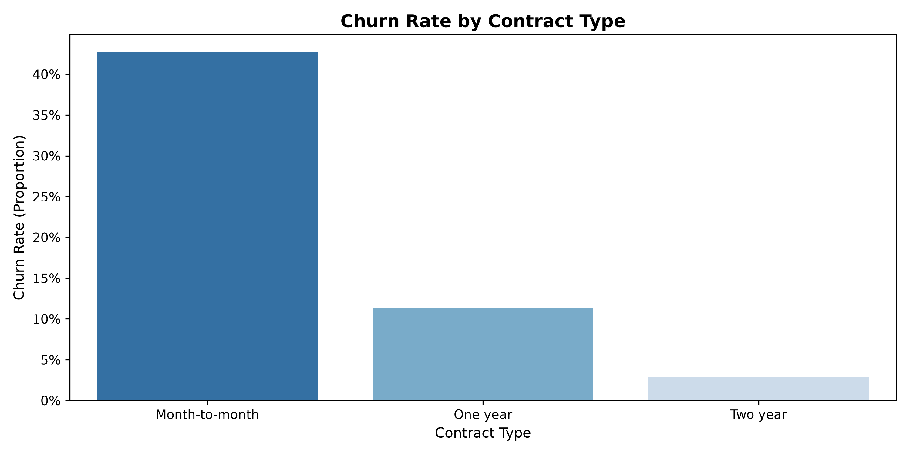
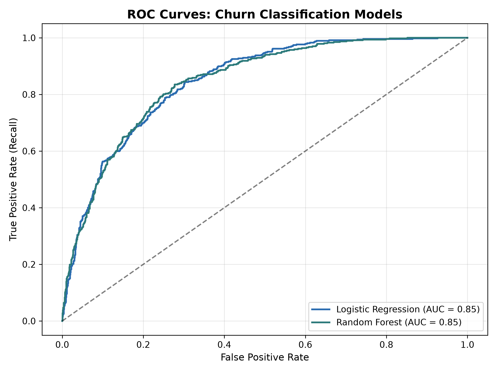
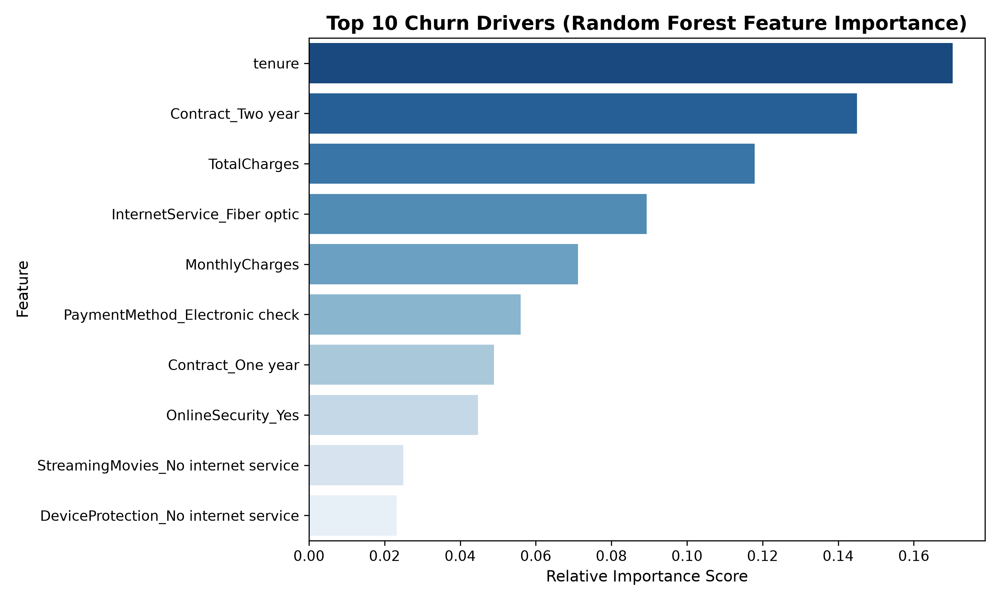

# Telco Customer Churn Prediction & Retention Analytics

An end-to-end Machine Learning and exploratory analytics project designed to identify high-risk customer segments, isolate primary churn drivers, and build predictive classification models to improve retention in subscription-based services.

---

## 📌 Business Problem & Impact

Customer attrition is significantly more expensive than customer acquisition. In subscription businesses, early detection of churn signals allows retention teams to deploy proactive retention campaigns before accounts cancel service.

* **Target Variable:** Customer attrition (`Churn`: Yes / No).
* **Core Objective:** Build a model maximizing **Recall** (capturing at least 75%+ of actual churners) while maintaining a balanced **ROC-AUC > 0.83** to minimize wasted spend on non-churners.
* **Key Commercial Finding:** Over **42% of month-to-month contract users churn**, compared to **under 3%** of customers locked into two-year contracts.

---

## 📊 Key Visualizations & Findings

### 1. Exploratory Analysis: Contract Duration Impact
Month-to-month contracts represent the highest churn risk across the entire customer base. Long-term commitments dramatically reduce account attrition.



### 2. Model Performance: ROC-AUC Comparison
Both models achieve strong predictive separation on unseen holdout test data, with **Random Forest achieving an ROC-AUC of 0.84**.



### 3. Primary Churn Drivers (Feature Importance)
Model explainability reveals that short tenure, high monthly charges, and contract type dominate churn probabilities.



---

## 🔍 Model Evaluation & Comparison

Models were trained with stratified sampling and calibrated using balanced class weights (`class_weight='balanced'`) to prevent bias toward the majority non-churn class:

| Model | ROC-AUC | Churn Recall | Precision | Best Use Case |
| :--- | :--- | :--- | :--- | :--- |
| **Logistic Regression (Baseline)** | **0.84** | **79%** | 0.52 | High interpretability; calculating exact odds ratios for pricing tiers |
| **Random Forest Classifier** | **0.84** | **76%** | 0.55 | Production scoring; capturing non-linear relationships and interactions |

* **Selected Approach:** Logistic Regression is prioritized when marketing teams need granular feature-by-feature coefficients for pricing strategy. Random Forest serves as the production inference model for weekly scoring batches.

---

## 💡 Strategic Business Recommendations

1. **Incentivize Annual Commitment:** Provide an upfront discount or service credit during months 1–3 to encourage migration from month-to-month to 1- or 2-year agreements.
2. **First 6-Month Onboarding Focus:** Because `tenure` is the leading predictor of attrition, customers within their first 180 days require dedicated onboarding checkpoints and usage tracking.
3. **High Monthly Charge Audits:** Customers paying above $70/month on basic tiers show heightened price sensitivity; automated alerts should prompt customer success to offer optimized service bundles before cancellation requests occur.

---

## 🛠 Tech Stack

* **Environment:** Python 3.10+
* **Data Manipulation:** `pandas`, `numpy`
* **Machine Learning:** `scikit-learn` (`StandardScaler`, `LogisticRegression`, `RandomForestClassifier`, `roc_auc_score`, `train_test_split`)
* **Visualization:** `matplotlib`, `seaborn`
* **Dataset:** IBM Telco Customer Churn dataset (7,043 customer accounts, 21 attributes).

---

## 📁 Repository Structure

```text
├── churn_analysis.py            # Complete ETL, modeling, evaluation & plotting pipeline
├── eda_churn_insights.png       # Contract tenure vs. churn rate visualization
├── feature_importance.png       # Top 10 predictive features ranking
├── roc_curve_comparison.png     # ROC-AUC evaluation curves
├── churn_business_summary.csv   # Model performance metrics export
└── README.md                    # Business analysis and methodology report